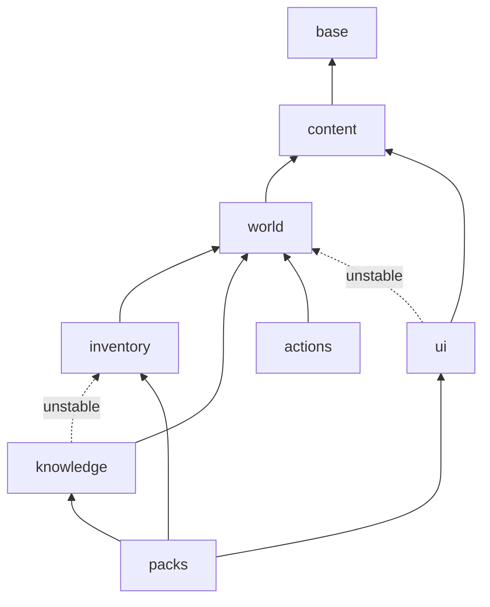

# Architecture

Enshwick has four parts. A `powrprof.dll` stub starts the loader inside the
game. The loader owns everything that knows the engine. Mods talk to the loader
only through a versioned C ABI, and the `enshwick` crate wraps that ABI in a
safe API.

## Crates

`crates/internal/` holds the parts behind the facade, which only `enshwick`
re-exports; `crates/runtime/` holds what `enshwick.zip` ships into the game.

| Crate | Where | Owns | Published |
| --- | --- | --- | --- |
| `enshwick` | `crates/enshwick` | the one crate mods use: the facade that re-exports every module of its internal parts at its own paths, the crate docs, the macros' docs and the features | yes |
| `enshwick-core` | `crates/internal/core` | `Load` with its forwarders into the domains' crates, `declare_mod!`'s support, and the script binding's namespace lists | yes |
| `enshwick-base` | `crates/internal/base` | what every domain shares (the host handle, events, services, points, settings, texts, state, the resource codec, the ECS reads, the lock policy) and the base handle `Load` holds | yes |
| `enshwick-content` | `crates/internal/content` | the content domain: content, rates, and the shape samples of the generated typed items, which it re-exports from `enshwick-typed` | yes |
| `enshwick-world` | `crates/internal/world` | the world domain: `World` and the live world's map, voxels, terrain, weather, time of day, altars, buffs and game settings, and the typed handles that read a live world | yes |
| `enshwick-inventory` | `crates/internal/inventory` | the inventory domain: inventories and items, item and entity data, affixes, stats, damage, effects, survivors and loot | yes |
| `enshwick-knowledge` | `crates/internal/knowledge` | the knowledge domain: knowledge, quests and the journal, progress (skills, comfort, experience) and rewards | yes |
| `enshwick-actions` | `crates/internal/actions` | the actions domain: player actions and their windows, console commands, controls and the players' input, chat, interactions and vetoes | yes |
| `enshwick-ui` | `crates/internal/ui` | the ui domain: the client's interface drawn with the game's own widgets (frames, the HUD, dialogs, map markers, screen panels) and sound | yes |
| `enshwick-packs` | `crates/internal/packs` | the packs domain: data packs, the content a mod describes in TOML files, read, checked and added through the domains below it but actions | yes |
| `enshwick-typed` | `crates/internal/typed` | the generated typed API, re-exported as `enshwick::typed` | yes |
| `enshwick-values` | `crates/internal/values` | the value types the layers share: shape, content ids, resource values, the script value model | yes |
| `enshwick-abi` | `crates/internal/abi` | the `repr(C)` types that cross between the loader and a mod, the ABI version and its golden layout file, and the reads and writes of game memory, re-exported as `enshwick::abi` and `enshwick::raw` | yes |
| `enshwick-macros` | `crates/internal/macros` | `#[hook]`, `#[config]` and the other macros of the API | yes |
| `enshwick-fake` | `crates/internal/fake` | the fake loader for a mod's unit tests, re-exported as `enshwick::test` behind the `test` feature | yes |
| `enshwick-loader-stub` | `crates/runtime/stub` | the `powrprof.dll` proxy: forwards the system exports, holds the dedicated server's entry point and starts the loader | no, in `enshwick.zip` |
| `enshwick-loader` | `crates/runtime/loader` | the loader DLL: finds the game build, loads and resolves mods, links their hooks, answers the ABI | no, in `enshwick.zip` |
| `enshwick-luau` | `crates/runtime/luau` | Luau mods: one sandboxed VM per mod with memory and time budgets, the API bound from the script descriptions of `enshwick` and its internal parts | no, in `enshwick.zip` |
| `enshwick-gamedata` | `crates/enshwick-gamedata` | game data the loader and the tools share: the engine routes and anchors, the compatibility reports, the engine's reflection reader (`reflect`) and the game archive reader (`archive`) | yes |
| `cargo-enshwick` | `crates/cargo-enshwick` | the one tool for mod authors: new mods, install, manifests, content packs, point definitions, the game's types from reflection, porting a table to a new build; its library reads point schemas for tests and fuzzing | yes |
| `xtask` | `tools/xtask` | repository checks, the release archive and alpha notes, and `cargo xtask compat`, the maintainers' report of what works on a game build | no |
| `enshwick-fuzz` | `fuzz` | the fuzz targets for untrusted input, a workspace of their own | no |
| examples | `examples/*` | the whole mods and packs the book follows | no |

## Layers

```text
stub ──starts──▶ loader ──C ABI──▶ mods (enshwick ▸ enshwick-macros)
                   │
                   ├──▶ enshwick-core, enshwick-abi
                   ├──▶ enshwick-gamedata (tables, reflect, archive) ──▶ enshwick-content, enshwick-base
                   └──▶ enshwick-luau ──▶ enshwick-core (script descriptions)
cargo-enshwick ──▶ enshwick-core, enshwick-abi, enshwick-gamedata
enshwick ──▶ enshwick-core ──▶ enshwick-actions ──▶ enshwick-inventory ──▶ enshwick-world ──▶ enshwick-content ──▶ enshwick-base ──▶ enshwick-abi ──▶ enshwick-values
                                                                                              enshwick-content ──▶ enshwick-typed ──▶ enshwick-values ──▶ enshwick-macros
             enshwick-core ──▶ enshwick-knowledge ──▶ enshwick-inventory
             enshwick-core ──▶ enshwick-packs ──▶ enshwick-ui ──▶ enshwick-world
                               enshwick-packs ──▶ enshwick-knowledge, enshwick-inventory
enshwick ──test──▶ enshwick-fake ──▶ enshwick-core (its `fake` feature)
```

- `enshwick` is the one crate a mod names, a facade over its internal parts,
  each re-exported under its paths: `enshwick-core`, `Load`; `enshwick-packs`,
  `enshwick-ui`, `enshwick-actions`, `enshwick-knowledge`,
  `enshwick-inventory`, `enshwick-world` and `enshwick-content`, a crate per
  domain; `enshwick-base`, what every domain shares; `enshwick-fake`,
  the fake loader; `enshwick-typed`, the generated
  typed API; `enshwick-abi`, the ABI; `enshwick-values`, the value types the
  layers share. None depends on `enshwick` or on a part above it, so the
  compiler refuses ABI code that names the safe API and core code that names
  the fake.
- The fake reaches inside `enshwick-core` only through its hidden `__fake`
  module, which only core's `fake` feature builds and only `enshwick-fake`
  turns on, so a mod's release build holds no test support. Core asks the
  fake about a mod's manifest through one check the fake hands down at
  install. The fake's code names core as `enshwick_core`.
- `enshwick-core`, the domains' crates and `enshwick-fake` take `enshwick` as a dev-dependency,
  so their doc examples name the real facade and build as one binary; cargo
  drops a dev-dependency without a version when it publishes. Another
  internal part's doc example names its own crate `enshwick` by a hidden
  `# extern crate <crate> as enshwick;` line. One that names items above its
  crate sits in a hidden wrapper, and `crates/enshwick/src/lower_examples.rs`
  compiles its copy; `cargo xtask check` holds both.
- Only mods depend on `enshwick`. The loader, `enshwick-luau`,
  `enshwick-gamedata` and `cargo-enshwick` name the internal parts they need,
  `enshwick-core` (`enshwick-gamedata` only `enshwick-base` and
  `enshwick-content`) and, for the API's version, `enshwick-abi`; they take
  `enshwick` only for their tests, which build mods and reach the fake, and
  `cargo xtask check` refuses a crate in `crates/` or `tools/` that takes it
  for more. A crate that uses the macros without the facade names the crate
  their expansion reaches with the hidden argument `crate = "path"`, as the
  loader's settings do with `crate = "::enshwick_core"`.
- Nothing depends on the loader except xtask's `compat` feature; cargo-deny
  refuses it anywhere else.
- `enshwick` never depends on the loader or on `enshwick-gamedata`: a mod links
  the API alone.
- `cargo-enshwick` shares code with the loader only through `enshwick-gamedata`
  and the ABI types.
- What a script language reaches is described once, beside the Rust items, in
  `enshwick::script`: `#[derive(Script)]` on types, `#[script]` on methods and
  the event tables. `enshwick-luau` binds those descriptions to Luau and
  `cargo-enshwick` writes the Luau definitions from them; neither keeps a
  list of its own. Only `enshwick-luau` links Luau.

## Domains

`crates/internal/core/domains.toml` orders the domains of the API, lowest
first: base, content, world, inventory, knowledge, actions, ui, packs, and
names the crate of each. Every domain has a crate of its own; the one module
`enshwick-core` keeps besides `Load` and `declare_mod!`'s support is
`script`, the script binding's namespace lists, which open each domain's
handles through `Load`, over the binding's runtime in base.

`enshwick-core` is the top layer: `Load`, the handle a mod's `init` gets,
whose typed methods are its way into the high level of the API, each
forwarding into its domain's crate, where the high-level types such as
`World`, items and windows live. `enshwick-base` holds what every domain
shares, the high-level events, services, settings, texts, state and
scheduler among it, and the supported mid level: the resource codec and the
ECS reads, which reach any game data. The low level, hooks and the mod's own
manifest rows, sits in `enshwick-base` and `enshwick-abi`.

- A module names only its own domain and the domains before its own.
  Something two domains share moves down into base or the lower domain.
- `cargo xtask check` reads the code's `crate::` paths, and the calls on
  `self` in each module's `Load` methods, without compiling and refuses an
  edge up the order. The list of edges up the order in `domains.toml`,
  `upward`, is empty and stays so: a new edge fails.
- A domain's crate depends, among the internal crates, only on those below
  every domain (`below` in `domains.toml`) and on the crates of the domains
  before its own; the check holds its manifest, and the compiler holds its
  code.
- The order allows an edge; only the code makes one. A domain's crate, and
  core, depend on an internal crate only where their code outside tests
  names it: one that only tests name is a dev-dependency, and one named
  only under a `cfg(feature)` is optional and turned on by that feature.
  The check fails on any other, so the domains form a graph, not a chain,
  and siblings compile side by side.
- Registration lists are one per domain, joined in the domain order: the
  script namespaces in `script/namespaces/<domain>.rs`, which the check also
  holds to the map. The loader's parts are one list per layer, joined in
  `parts.rs` (see "Inside the loader").
- The fake loader follows the same map: each file under
  `crates/internal/fake/src/test/` and `test/table/` sits in the folder of
  its domain, `test.rs` and `test/table.rs` join them, and the check holds
  its edges, to the fake's domains and to core's, by the same rule with
  their own `upward` list under `[fake]`. The fake stays one crate above
  core: a peel moves no fake file into its domain's crate, since the
  presets are inherent methods of `FakeHost`, which only this crate may
  add.
- Each domain turns its own errors into `Off`, and keeps the state it needs
  while a mod initialises in the base handle's typed slots, keyed by a type
  of its own, so `Load` names no domain.
- `Load` stays in `enshwick-core`, the top layer; `World` left with the world
  domain, its methods inherent there, since only that domain adds to it.
  `Load` holds the
  base handle, `BaseLoad`, which every crate below takes for the mod's init;
  a public function below `Load` that takes the mod's loader takes
  `&impl Loading` or `&mut impl Loading`, so a mod passes its `Load` as
  before.

The domains' graph, each arrow a dependency, an edge a longer path already
gives left out; a dotted arrow exists only with `unstable`. Core sits over
all of them.



### Peeling a domain out of the core

Domains left the core downward, lowest first, each in one pull request
that kept `enshwick`'s public API equal: base, content, world, inventory,
knowledge, actions, then ui and packs. A new domain starts as a crate of
its own; these steps hold for one that grows inside core first.

1. Make the crate `crates/internal/<domain>` (`enshwick-<domain>`): exact
   pins, the description "Internal part of enshwick; depend on enshwick",
   `#![forbid(unsafe_code)]` where it has none, `extern crate self as
   enshwick;` and a root that holds the paths the macros emit. Its
   dependencies are base, the lower domains' crates and the crates of
   `below`. Name it under `[crates]` in `domains.toml` and drop its modules
   from `[modules]`.
2. Move the domain's modules with `git mv`. Each `impl Load` block moves with
   `cargo xtask peel-load <from>=<into>`: the block becomes an `impl
   BaseLoad` block whose methods carry one hidden doc line, and its docs,
   examples and `#[script]` go to a block of bodiless methods on `Load` in
   `core/src/load/<module>.rs`, whose bodies `#[forward(base)]` writes. That
   form holds only in `enshwick-base`, the crate of `BaseLoad`: Rust lets no
   other crate add inherent methods to it (E0116). Above base `peel-load`
   puts a module's public and scripted methods on its hidden trait
   `LoadMethods` and the rest on the crate-private `LoadHelpers`, each
   implemented for `BaseLoad` with the bodies as written; the crate's
   `src/__load.rs` re-exports each trait as `_`, and the forwarder file
   imports them all with `use enshwick_<domain>::__load::*`, as does each
   peeled module that calls a method another module of the run moved; a
   peeled module loses its import of core's `Load`. The traits stay
   nameable, hidden, under the facade's modules: they offer nothing `Load`
   does not, and hiding them would take a nested module and a glob import of
   its parent in every peeled module. Peel the domain's
   modules in one run, so each knows the others' methods. `peel-load`
   writes a forwarder's links relative to its module as paths from the
   crate root, and rustdoc names one into a module private to the crate,
   which takes by hand a path core re-exports. The forwarder file imports
   by hand the module's own types its signatures name, and the compiler
   then names the copied imports it does not use. A module that is
   private becomes `pub(crate)`, so `__load` reaches its trait. A module
   that `cfg` gates in its parent gives its blocks, its `__load` lines and
   its forwarder `mod` that `cfg` by hand. A method whose closure takes
   `&mut Self` stays a method of `Load` that runs the closure and hands the
   outcome down.
3. Upward edges the moved code still has go first: what a lower layer needs
   moves down with it, such as the served-resource builder into
   `resources` and the host's resource reads, and what only an upper domain
   needs moves up, such as the rate rule into `rates`. An inherent method
   of a lower type, `Host` included, lives in that type's crate. A method
   that calls a `Load` method of a domain above, an edge up the check
   counts from a call on `self` in the domain's `Load` methods, keeps
   its body in core's forwarder file, as `limit_altar_level` (with
   crafting vetoes) and `on_fog_uncovered` (with the interface's frames)
   do, and reaches the crate's private parts through `__internal`.
4. Each `Bound` implementation moves with its type, beside the `LoadMethods`
   block or `#[script]` block it opens with: `Bound` lives in base's
   `script`, and its `resolve` takes `&mut impl Loading`, so it opens the
   handle through the base handle as a forwarder does. Only the domain's
   namespace list stays in `core/src/script/namespaces/<domain>.rs`, since it
   lists `Load`'s start functions, which `#[script]` on the forwarders makes.
   A method only a script calls, such as `on_comfort_script`, goes to a
   `#[script(<part>)]` block of its own in core's
   `load/<module>/script.rs`, and its body to a `LoadMethods` trait in the
   module's private `script` module, never to the module's public trait;
   `peel-load` refuses one anywhere else.
5. What core calls inside the crate and a mod must not becomes a function
   of the crate's hidden `__internal` module, which neither core nor the
   facade re-exports, and the method behind it stays `pub(crate)`: a method
   on a type the facade shows is in a mod's reach, hidden or not.
   `crates/enshwick/tests/ui/internals_out_of_reach.rs` holds that a mod
   names none of them. A type only a script's handler gets, which a
   forwarder's signature names, such as `ScriptDamage`, is public inside a
   module private to the crate, its `script` module, and core names it
   through `__internal`; a crate-private helper core calls takes
   `&mut impl Loading` there. The fake's part goes into the crate's own hidden
   `__fake`, behind a `fake` feature that core's turns on, which core's
   `__fake` re-exports; so do the fixtures core's tests build on, each in a
   `fixtures` module beside the tests it comes from. Core re-exports
   the crate's modules at the paths its own code names them by, and the
   facade re-exports them at today's paths.
   A doc link from the crate to `Load` or a domain above is a relative
   URL to the facade's page, such as
   `[`Load::add_item`](../struct.Load.html#method.add_item)`, one `../`
   deeper on a nested public module's own docs, never in a
   module's first paragraph, which the crate's index shows one folder up;
   `cargo xtask doc-links` checks each one in the facade's rendered docs.
6. Give each doc example the alias line with `cargo xtask alias-examples`,
   run the crate's doctests without its features and with them, and feed
   each log to `cargo xtask wrap-examples <log> [--cfg <feature>]`, which
   wraps the examples that name items above the crate and writes their
   copies into `crates/enshwick/src/lower_examples/<crate>[_<feature>].rs`.
7. A domain gets a cargo feature only when the API above works without it:
   base, content, world and inventory, without which the domains above them
   do not build, have none. A domain's feature, on by default, is an optional dependency on its
   crate plus a `cfg` on core's forwarders and the facade's re-exports, and
   turns on the features of the domains it rests on.

## The ABI contract

- Every type that crosses the loader and a mod is a `repr(C)` struct in
  `enshwick::abi` behind a size-and-version header.
- The loader hands each mod one `HostApi` table of `extern "system"` functions;
  a mod exports `enshwick_mod_abi`, `enshwick_mod_query`, `enshwick_mod_init`
  and `enshwick_mod_ready`, which `declare_mod!` writes.
- The ABI version is a major and a minor, the first line of the committed
  layout file `crates/internal/abi/src/abi/layout.txt`, which lists every
  field's offset, size and type, function pointers with their signature.
  An append is the next minor, any other change a new major, and the layout
  tests refuse a change without its bump. A mod of another major, or of a
  newer minor than the loader's, is refused with what to do.
- Strings are borrowed for the call, and memory is never freed across the
  boundary.
- Nothing unwinds across it: the loader catches every panic in a mod's call or
  detour and turns off that feature or that mod, never the game.

## Where engine knowledge lives

- Engine type and field names, offsets, addresses, function signatures and
  patterns live in the loader and in `enshwick-gamedata`'s anchors, never in
  `enshwick` or in a mod.
- Facts the engine reflects are found by name through `reflect` and hold across
  game builds. Entries an engine route reaches come next: the loader finds
  them in the game's code through what the engine names (its ECS systems,
  its debug strings), on every build, from the data in
  `crates/enshwick-gamedata/anchors/routes.toml`. The few no route reaches
  are pattern rows without an address in
  `crates/enshwick-gamedata/anchors/patterns.toml`, carried to every build
  first; a route that finds another address than its anchor turns the entry
  off. No file is made per build: what neither a route nor an anchor finds
  turns off, and a build where nothing is missing runs without a warning.
- The tables of the kept builds, and the reflection catalogues the typed API
  is generated from, lie outside the repository, in the game data folder
  `ENSH_GAMEDATA` names; the tests compare the routes and anchors with them
  and skip without them, and the loader does not read them. `reports/`
  holds the compatibility report of each build, a sealed test record that
  `cargo xtask check` reads. Enshwick supports the latest game version: the
  docs site and the release notes name only the newest report of each side.
- `crates/enshwick-gamedata/anchors/classes.toml` classes every table entry:
  found from the engine, or a pattern because research found no route, each
  with its reason; a test fails on an entry without one.
- In the loader, each symbol and constant it finds is declared once in
  `pinned/<part>.rs` as a typed `Symbol` or `Constant`, and code names it by
  path, such as `pinned::world::TIME`. Each part lists the ids it needs in its
  `TABLE_IDS`, which its layer's part list names and `cargo xtask compat`
  reads; a test refuses an id spelled as a string.
- A mod asks for a game feature through the API. The loader owns the hook on
  that feature and hands mods typed callbacks.

## Inside the loader

- The loader's modules sit in a folder per layer under `src/`: `engine`, the
  hooking engine, raw game access and the loader's state, below the domains
  of `domains.toml`, each in a folder of its name (`world/weather.rs`,
  `inventory/survivors.rs`). A domain's module named like the domain takes
  its own name there (`ui::interface`, `knowledge::store`).
- `start` identifies the game and its table, loads the mods in `mods/`, calls
  their `init`, arms the hooks and calls `ready`. `host` answers the ABI
  table, its entries cut by domain as the fake loader's table is
  (`host/entries/<domain>.rs`) and joined in `host/api.rs`. `events` links
  the server's step, its state changes and a player's join and leave.
  `parts` joins the layers' part lists. These four join every layer.
- Each layer registers its modules in one list, `PARTS` in `<layer>.rs`: a
  `Part` per module with its build table ids and what the joins call in it
  (seal, link, its work at a stage of the server step, a player's join and
  leave, a hosted game's start and end, the world's loaded, saved and
  shutdown events). The joins walk the layers in the order of `domains.toml`
  and each list in its own order, so a domain's change touches its own list
  only. Each call the game's threads make runs under a fuse of its own. A
  snapshot test pins each phase's order; a change to it is made with its
  reason.
- The `[loader]` table of `domains.toml` holds the layers to the domain
  order: a module names only its own layer and those below it, and no join;
  `cargo xtask check` reads the paths, globs, exported macros and the
  methods a module adds to another's type, and refuses a new edge up. The edges
  up still in the code are listed there, module by module, and only go.
- `engine::loader` holds the one `Loader`, installed once at start: the
  build, the mods' records, the hook chains and the subscriptions.
- `engine::detour`, `engine::mid` and `engine::chains` are the hooking
  engine: one detour per target, mods linked through atomic slots,
  mid-function hooks with the full CPU state.
- What mods register during `init` goes into a `Registry`. The registry is
  sealed before the game runs, and hot paths read the sealed slice without a
  lock.
- Memory the loader hands the game, such as filtered lists or texts, goes
  through `retire`: it is freed only once the game's own world has stepped past
  the callers that read it.
- A large module is split by domain into `<module>/<domain>.rs`, with its tests
  in `<module>/tests.rs`, so no source file grows past about 1,000 lines.
- Modules that need no Windows API build and test on every host. The rest sits
  behind `cfg(windows)`, and its tests run on Windows or under Wine.
